# EegFun.jl

[](https://igmmgi.github.io/EegFun.jl/dev/)
[](https://github.com/igmmgi/EegFun.jl/actions/workflows/ci.yml)
[](https://codecov.io/gh/igmmgi/EegFun.jl)
[](https://opensource.org/licenses/MIT)


A Julia package for EEG/ERP data analysis and visualization. Currently under active development.

## Documentation

[**View the full documentation →**](https://igmmgi.github.io/EegFun.jl/dev/)

The documentation includes:

- Installation instructions and getting started guide
- Tutorials and Demos
- Complete API reference

## Installation

You can install EegFun.jl through the standard Julia package manager.

### Standard Installation

From the Julia REPL, enter Pkg mode by pressing `]` and run:

```julia
add EegFun
```

Or using `Pkg` in the code:

```julia
using Pkg
Pkg.add("EegFun")
```

**Note for plotting:** `EegFun.jl` uses [Makie.jl](https://docs.makie.org/) for visualizations. To display plots or use the interactive GUIs, you must also install a Makie backend of your choice:

- `add GLMakie` (Recommended for interactive GUIs and the Data Browser)
- `add CairoMakie` (Recommended for static, publication-quality plots or headless servers)

### Development Version (via GitHub)

To install the latest development version directly from GitHub:

```julia
using Pkg
Pkg.add(url="https://github.com/igmmgi/EegFun.jl")
```

## Features

- **EEG/ERP Analysis**
- **EEG/ERP Interactive Plots (via Makie.jl)**
- **Time-Frequency Analysis**
- **Raw data to full ERP batch preprocessing pipelines**

## Showcase

### Data Browser

<details>
<summary>Show Code</summary>

```julia
using EegFun
using GLMakie
# raw data file and channel coordinates
dat = EegFun.read_raw_data("my_raw_file.bdf");
layout_file = EegFun.read_layout("my_layout.csv");
EegFun.polar_to_cartesian_xy!(layout_file)

# Julia EegFun type
dat = EegFun.create_eegfun_data(dat, layout_file);

EegFun.plot_databrowser(dat);
```

</details>

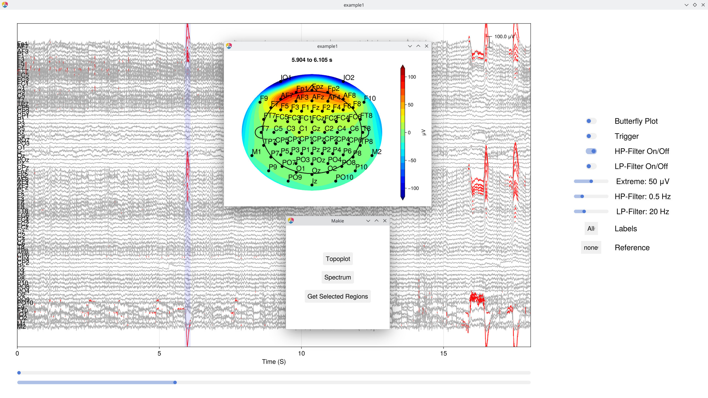

### ICA Data Browser

<details>
<summary>Show Code</summary>

```julia
using EegFun
using GLMakie
# raw data file and channel coordinates
dat = EegFun.read_raw_data("my_raw_file.bdf");

layout_file = EegFun.read_layout("my_layout.csv");
EegFun.polar_to_cartesian_xy!(layout_file)

dat = EegFun.create_eegfun_data(dat, layout_file);

# rereference data and apply 1Hz high-pass filter for ICA
EegFun.rereference!(dat, :avg)
EegFun.highpass_filter!(dat, 1)

# calculate EOG channels
EegFun.channel_difference!(
    dat,
    channel_selection1 = EegFun.channels([:Fp1, :Fp2]),
    channel_selection2 = EegFun.channels([:IO1, :IO2]),
    channel_out = :vEOG,
); # vertical EOG = mean(Fp1, Fp2) - mean(IO1, I02)
EegFun.channel_difference!(
    dat,
    channel_selection1 = EegFun.channels([:F9]),
    channel_selection2 = EegFun.channels([:F10]),
    channel_out = :hEOG,
); # horizontal EOG = F9 - F10

# detect some extreme values
EegFun.is_extreme_value!(dat, 200);

# ICA on continuous data without extreme values
ica_result = EegFun.run_ica(dat; sample_selection = EegFun.samples_not(:is_extreme_value_200))

EegFun.plot_ica_component_activation(dat, ica_result)
```

</details>

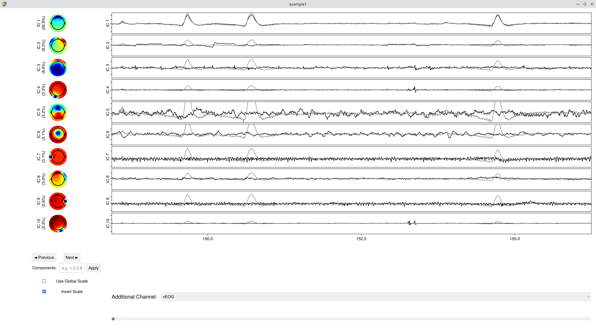

### Plot Gallery

| **Epochs (Grid Layout)** | **ERP (Topo Layout)** |
| :---: | :---: |
| 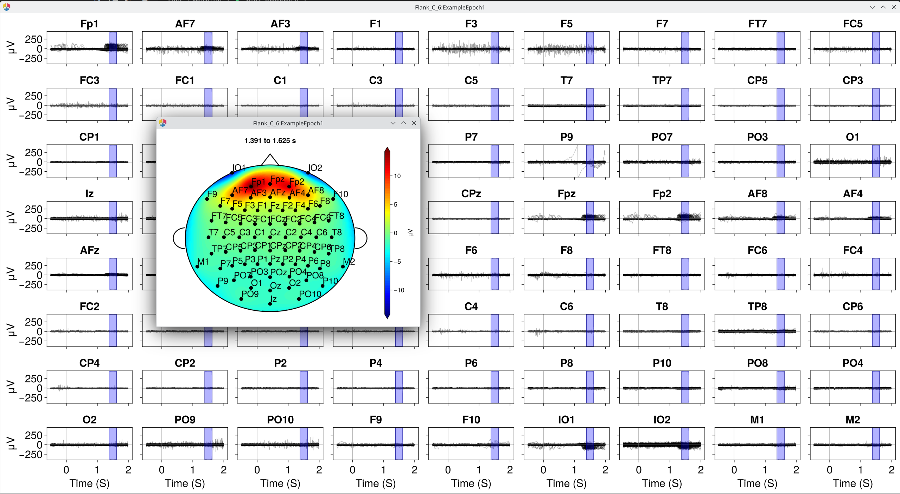 | 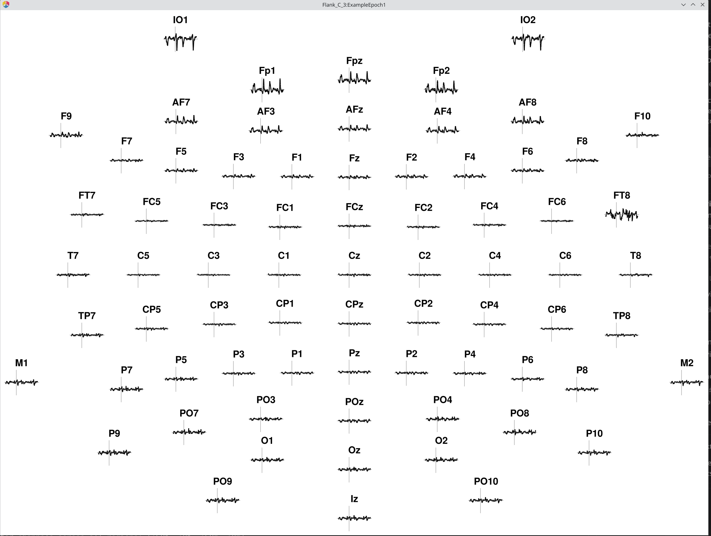 |
| **ICA Component Topographies** | **ICA Component Spectra** |
| 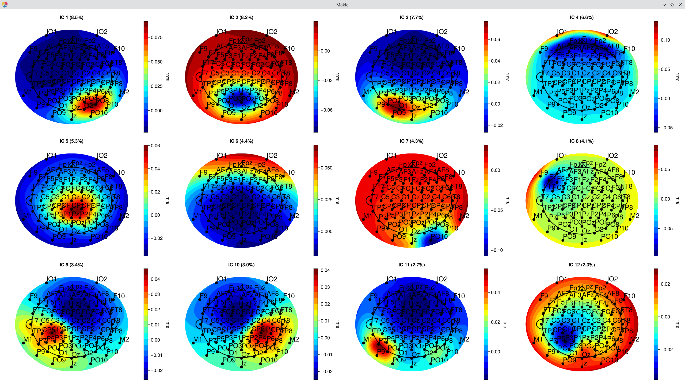 | 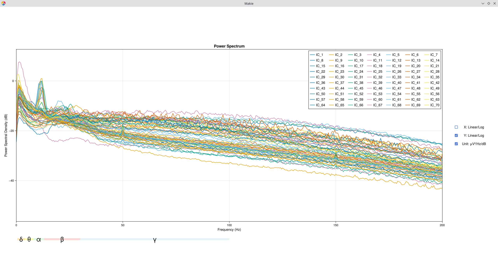 |
| **ERP Measurement GUI** | **ERP Filter GUI** |
| 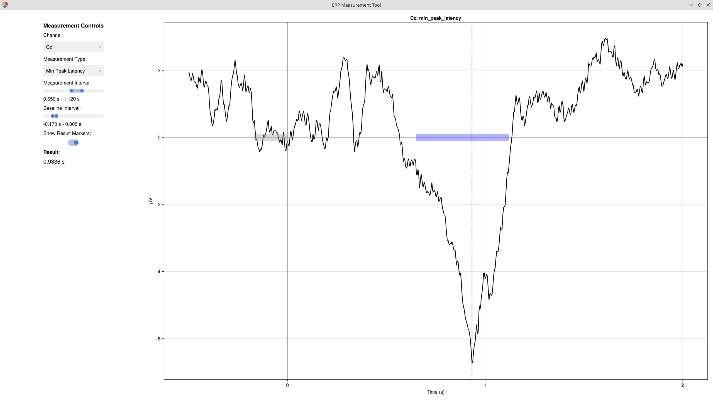 | 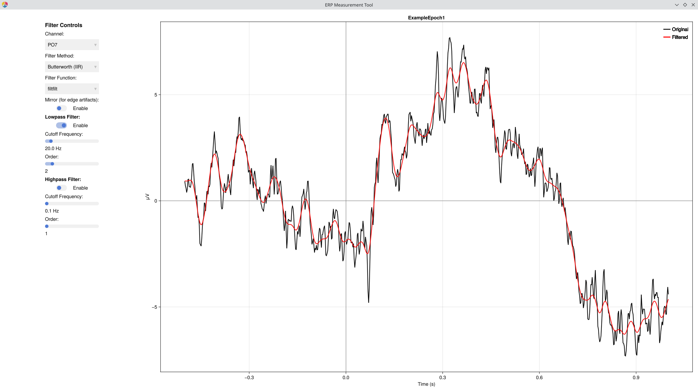 |
| **Time-Frequency Analysis** | **Triggers** |
| 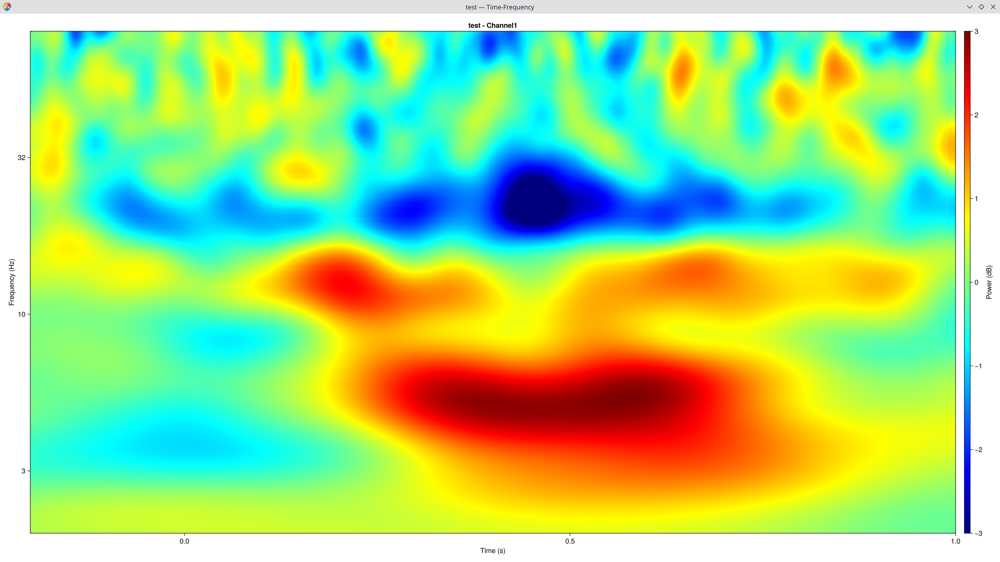 | 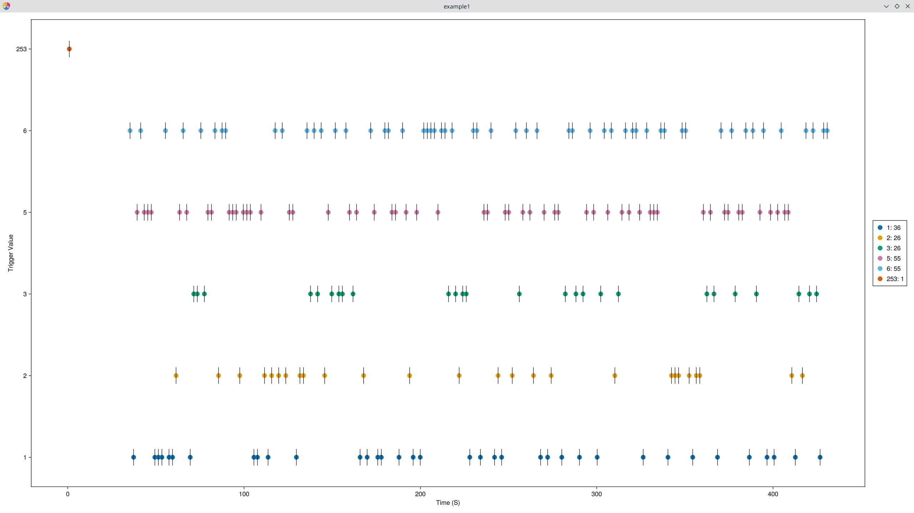 |
| **Plot GUI** | **Artifact Detection** |
| 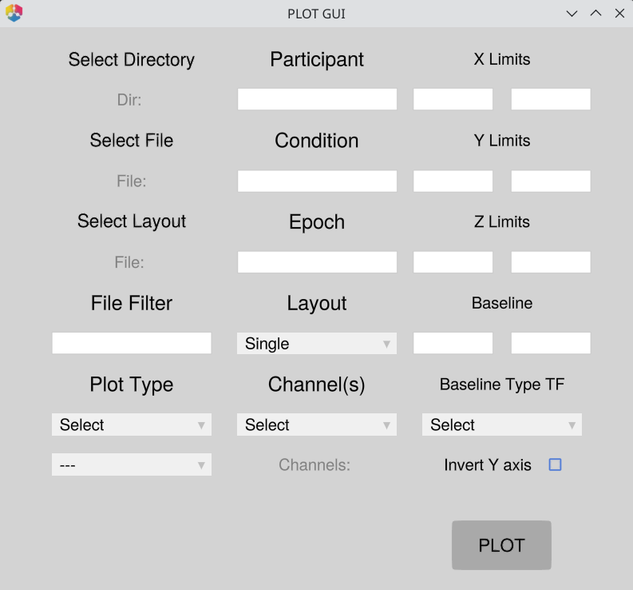 | 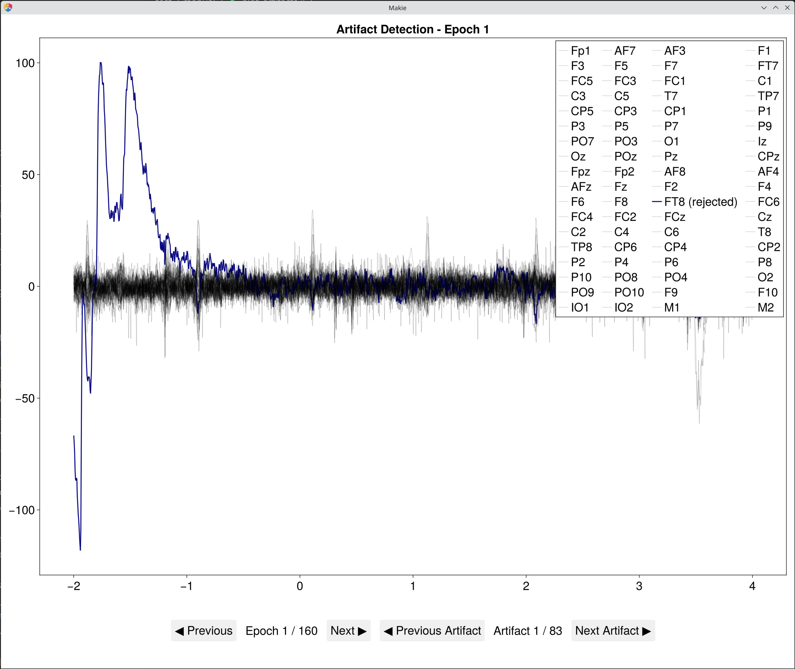 |

<details>
<summary>More Plot Examples</summary>

<details>
<summary>Artifact Detection</summary>


</details>

<details>
<summary>ERP Image (Topo Layout)</summary>

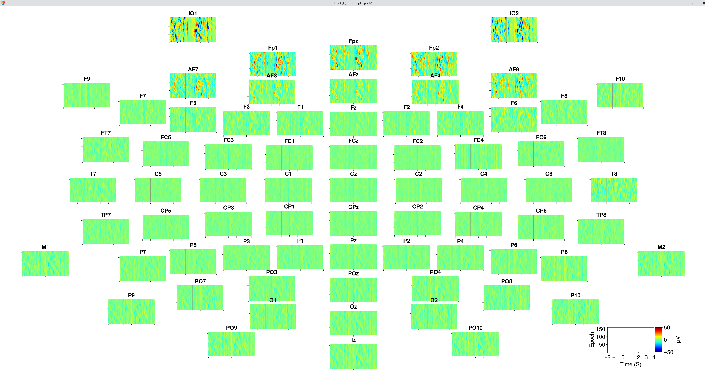

</details>

<details>
<summary>Epoch Plots (Grid Layout)</summary>


</details>

<details>
<summary>ERP (Topo Layout)</summary>


</details>

</details>
